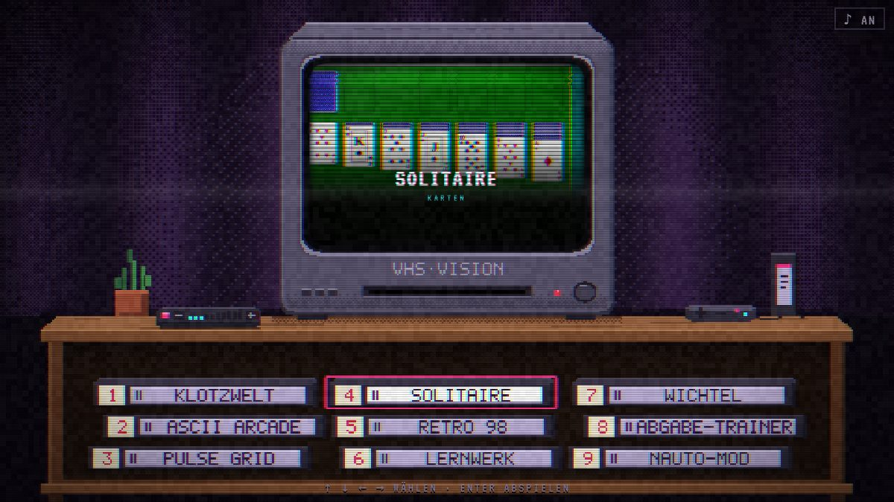
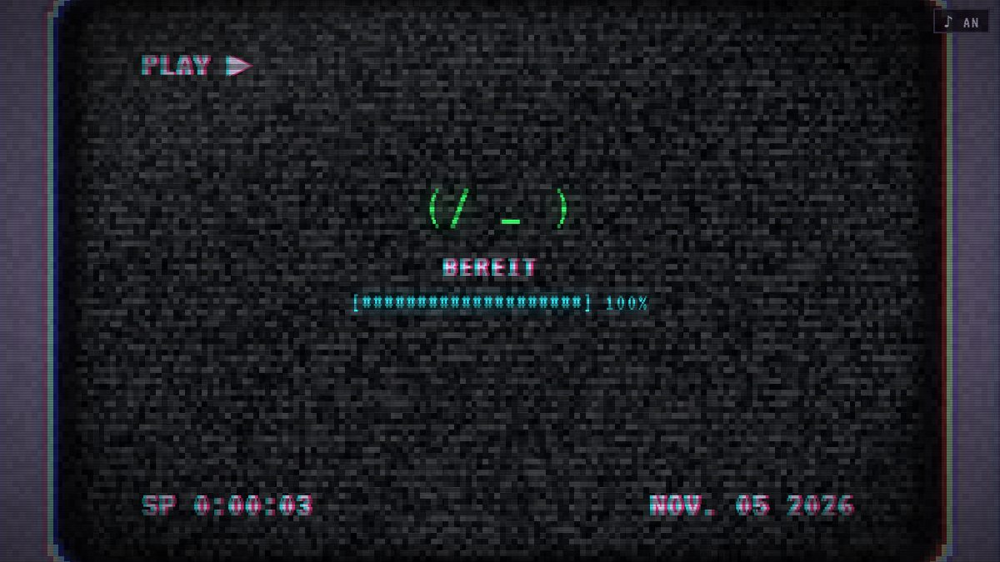
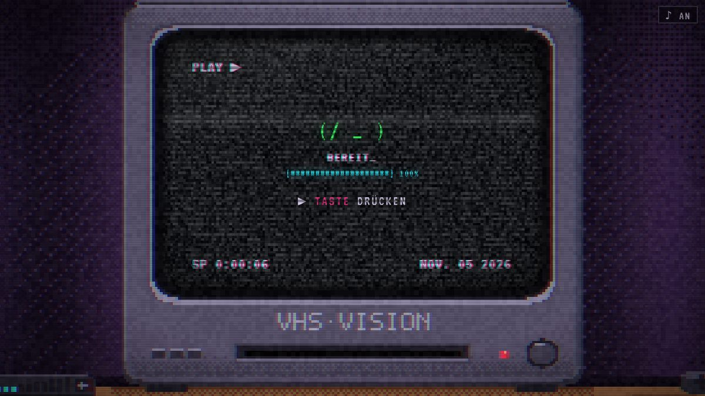
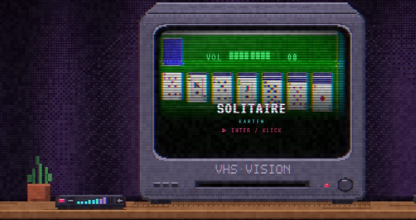
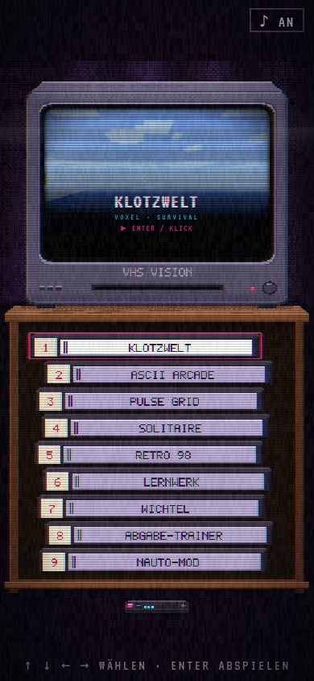
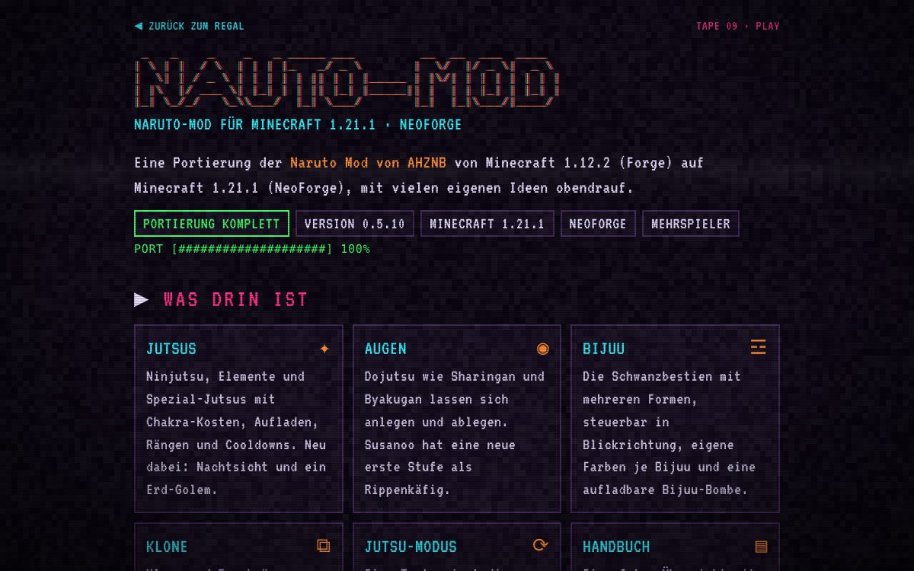

<div align="center">

```
 _   _ _   _ ____         __     _____ ____ ___ ___  _   _
| | | | | | / ___|   _    \ \   / /_ _/ ___|_ _/ _ \| \ | |
| | | | |_| \___ \  (_)    \ \ / / | |\___ \| | | | |  \| |
| |_| |  _  |___) |  _      \ V /  | | ___) | | |_| | |\  |
 \___/|_| |_|____/  (_)      \_/  |___|____/___\___/|_| \_|
```

**Ein alter Röhrenfernseher, ein Regal voller Kassetten und ganz viel Bildrauschen.**
Meine Browser-Spiele, Tools und Mods im VHS- und Pixel-Look.

### [▶ &nbsp;SEITE ÖFFNEN](https://michi3445.github.io/Nothing-yet/)



</div>

---

## ◉ So läuft's ab

| 1 · Einschalten | 2 · Laden | 3 · Rauszoomen |
|:---:|:---:|:---:|
|  |  |  |
| Der Fernseher geht an, Rauschen, **AV 1**. | ASCII-Ladebalken und ein kleines Gesicht `(/ _ )`. | Klick oder Taste: Die Kamera fährt langsam aus dem Fernseher heraus. |

Auf dem Regal stehen die Kassetten. Wer eine auswählt, sieht auf dem Fernseher eine Vorschau mit VHS-Farbversatz und Bandstreifen. Ein zweiter Klick legt die Kassette ein, die Kamera fährt in den Fernseher hinein und das Spiel startet.

## ▤ Kassetten

| # | Kassette | Was es ist |
|:-:|---|---|
| 01 | **KLOTZWELT** | Klötzchenwelt mit Überleben, Kreativmodus, Crafting, Monstern und Wetter |
| 02 | **ASCII ARCADE** | Doom, Pong, Tetris, Pacman und Nachtschicht, alles aus Textzeichen |
| 03 | **PULSE GRID** | Rhythmusspiel im 3×3-Raster, eigene Songs und Maps |
| 04 | **SOLITAIRE** | Klassisches Klondike im Retro-Fenster |
| 05 | **RETRO 98** | Retro-Desktop mit Startmenü, Paint, Minesweeper und mehr |
| 06 | **LERNWERK** | Aufgaben, Noten-Schnitt, Stundenplan, Karteikarten und 3D-Labor |
| 07 | **WICHTEL** | Sieht aus wie ein Weihnachts-Countdown, dahinter steckt eine Spielhalle |
| 08 | **ABGABE-TRAINER** | Übt das Abgabegespräch, eine KI spielt die Lehrkraft |
| 09 | **NAUTO-MOD** | Infoseite zur Naruto-Mod für Minecraft 1.21.1 |

Die Spiele in `games/` sind Kopien aus [Shittty-ahh-AI-games](https://github.com/Michi3445/Shittty-ahh-AI-games). Ändert sich dort ein Spiel, die Datei hier einfach neu hineinkopieren.

## ♪ Musik und Fernbedienung



Neben dem Fernseher liegt eine Fernbedienung. Damit stellt man die Lautstärke ein:

| Was | Wie |
|---|---|
| Lauter / leiser | Balken anklicken oder darüber ziehen, **−** / **+**, Mausrad oder Tasten `+` / `-` |
| Stumm | pinker Knopf oder Taste `M` |

Auf dem Fernseher erscheint dabei eine grüne **VOL**-Anzeige, und die Lautstärke bleibt gespeichert. Die Musik (`audio/intro.m4a`) ist der erste Song (0:00–4:10) aus einem lizenzfreien Musikvideo.

## ⌨ Steuerung

| Taste | Aktion |
|---|---|
| `←` `↑` `→` `↓` | Kassette wählen |
| `Enter` / Klick | Einlegen und starten |
| `+` / `-` / `M` | Lauter, leiser, stumm |
| `Esc` | auf der Nauto-moD-Seite zurück zum Regal |

## ▯ Auch am Handy



Hochkant ordnet sich alles neu: der Fernseher oben, die Kassetten untereinander im Schrank, die Fernbedienung liegt davor auf dem Boden. Antippen wählt, nochmal antippen startet.

Teilt man den Link in Discord oder WhatsApp, erscheint ein eigenes Vorschaubild.

<br clear="right">

## ✦ Nauto-moD



Eine Portierung der **Naruto Mod von [AHZNB](https://github.com/AHZNB/naruto_mod)** von Minecraft 1.12.2 auf **1.21.1 (NeoForge)**. Es gibt **keinen Download**: Die Nutzungsbedingungen des Originals erlauben keine veröffentlichten .jar-Dateien. Alle Ideen, Texturen, Modelle und Sounds stammen von AHZNB.

## ⚙ Technik

- Eine einzige `index.html`, kein Build-Schritt, läuft direkt über **GitHub Pages**
- Die ganze Szene ist Pixel-Art auf einem 480×270-Canvas (hochkant 270×480) mit eigener 5×7-Pixelschrift
- Bildrauschen, Farbversatz, Bandstreifen und Bild-Glitches werden live im Browser gezeichnet
- Alle Grafiken sind selbst gemacht, keine fremden Bilder

**Lokal testen:** Ordner öffnen und z. B. `python3 -m http.server` starten, dann `http://localhost:8000` aufrufen.

## ✓ Stand

- [x] TV-Intro mit Rauschen, AV 1 und ASCII-Ladebildschirm
- [x] Regal als Menü, Vorschauen auf dem Fernseher, Kamera-Zoom rein und raus
- [x] Fernbedienung als Lautstärkeregler
- [x] Nauto-moD-Seite
- [x] Handy-Ansicht und Teilen-Vorschau
- [ ] Deutsch / Englisch

<div align="center">

```
■ STOP   ◀◀ REW   ▶ PLAY   ▶▶ FF
```

</div>
